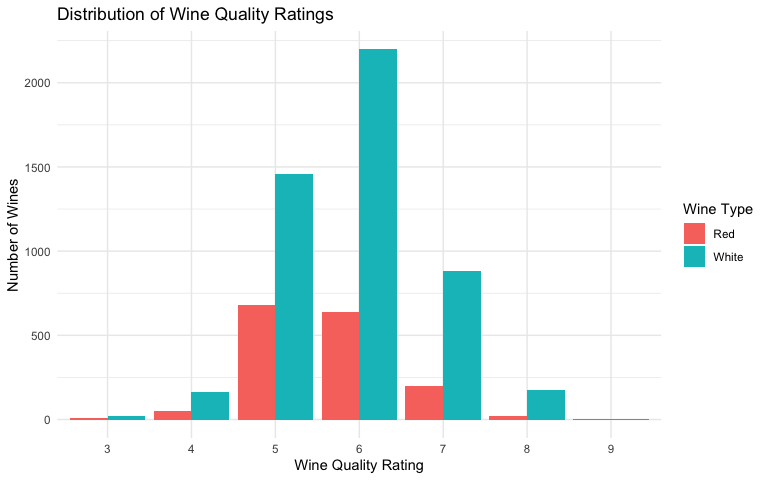
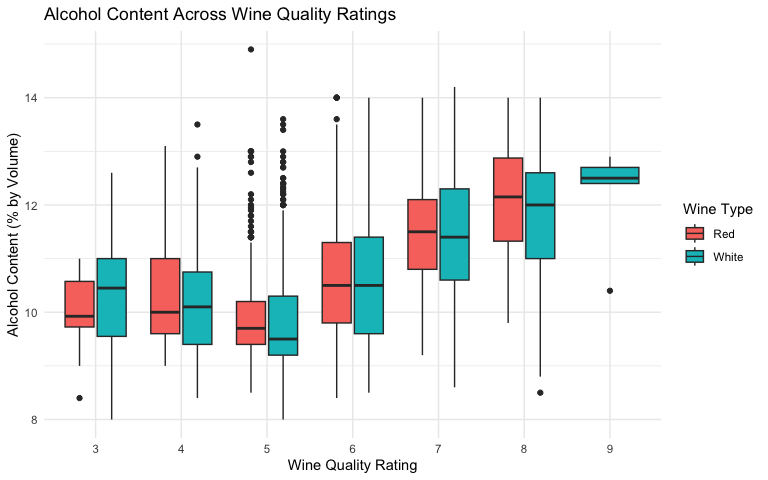
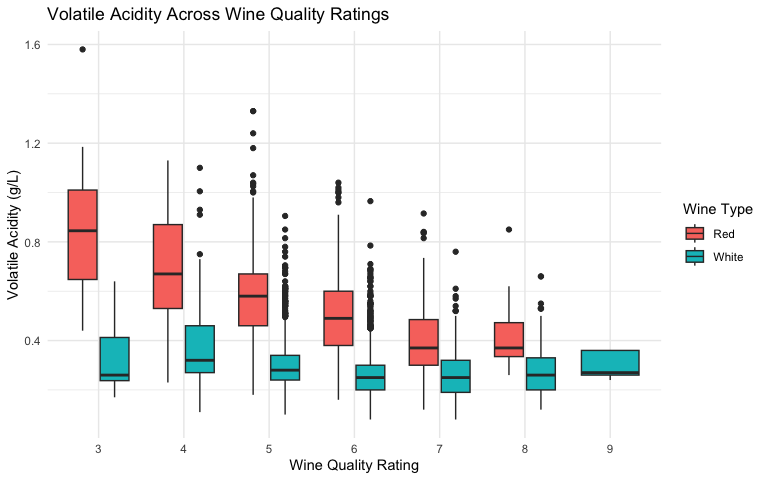
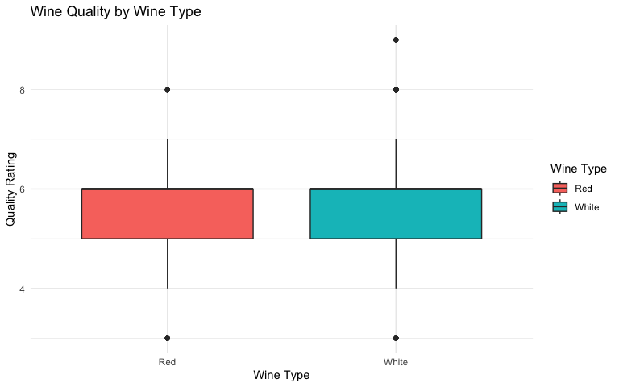
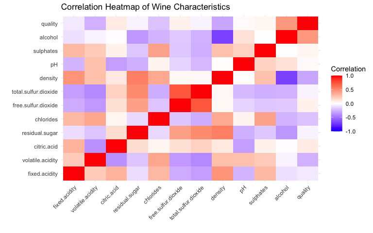
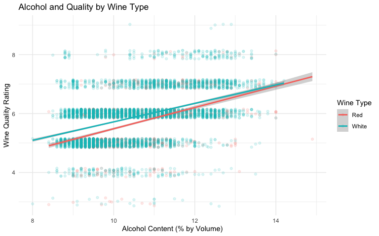
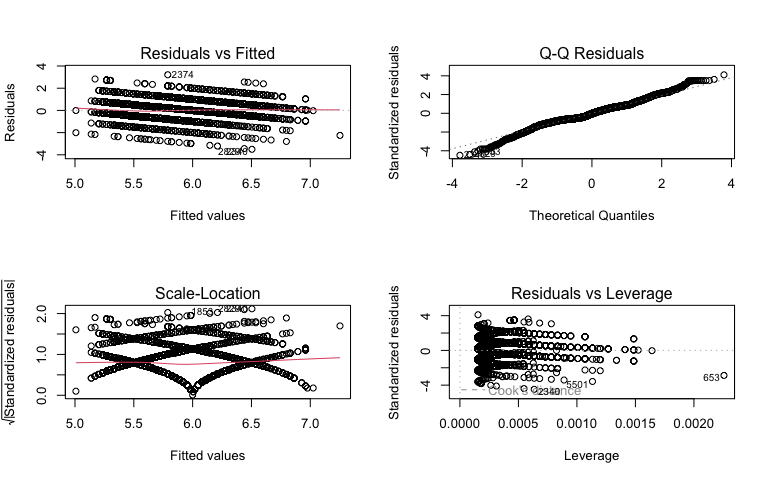
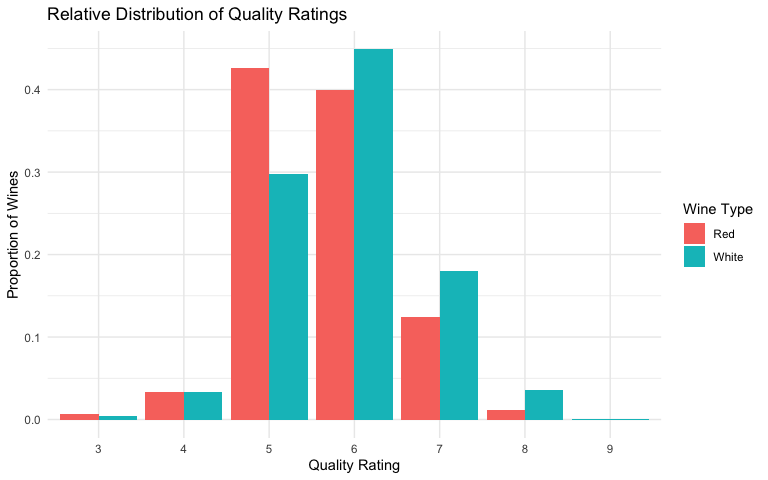
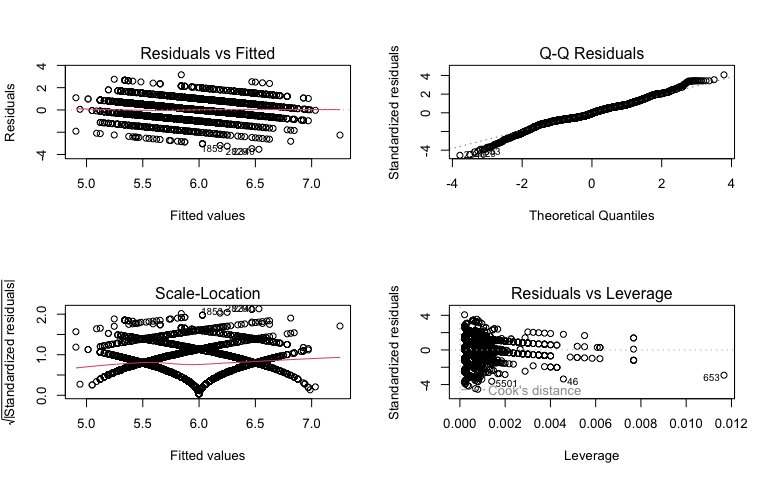

README
================

# 1. Business Understanding

## 1.1 Business Problem

Wine quality is influenced by a combination of chemical characteristics, production processes, and sensory properties. For wine producers, understanding which measurable characteristics are associated with higher quality can help inform decisions about fermentation, acidity management, and other aspects of production. However, wine quality is also subjective, meaning that chemical measurements alone may not fully explain how a wine is evaluated.

Research on wine quality suggests that physicochemical characteristics, including alcohol content and acidity, can provide useful information about sensory quality. Cortez et al. (2009) investigated whether chemical measurements could be used to predict wine preferences, demonstrating the potential value of analyzing measurable wine characteristics alongside sensory evaluations. The UCI Wine Quality dataset includes several measures of acidity, such as fixed acidity, volatile acidity, citric acid, and pH, as well as alcohol content and quality ratings assigned through sensory evaluation. These variables provide an opportunity to investigate whether differences in chemical composition are associated with differences in perceived wine quality. However, sensory quality is complex and subjective, and chemical measurements alone may not fully explain consumers’ or evaluators’ preferences. For wine producers, identifying relationships between alcohol, acidity, and quality could provide useful insights for quality-control practices and help identify characteristics that warrant further investigation (Cortez et al., 2009).

This project investigates the relationship between physicochemical characteristics and wine quality using the UCI Wine Quality dataset. The analysis examines both red and white Portuguese Vinho Verde wines to identify potentially useful patterns and determine whether the relationships between chemical characteristics and quality differ across wine types.

## 1.2 Research Questions

The analysis addresses four primary research questions:

1.  Is alcohol content associated with higher wine quality ratings?
2.  Does volatile acidity have a negative relationship with wine quality?
3.  Are there significant differences in average quality between red and white wines?
4.  Does the relationship between alcohol content and wine quality differ between red and white wines?

## 1.3 Business Relevance

These questions are relevant because identifying chemical characteristics associated with higher quality ratings could help wine producers prioritize further investigation and quality-control efforts. Comparing red and white wines may also reveal whether the same characteristics are equally informative for both types of wine. The findings are observational and will identify associations rather than establish causal relationships.

# 2. Data Understanding

## 2.1 Importing the Dataset

``` r
# Import red and white wine datasets
red_wine <- read.csv(
  "winequality-red.csv",
  sep = ";"
)

white_wine <- read.csv(
  "winequality-white.csv",
  sep = ";"
)

# Add a variable identifying wine type
red_wine$wine_type <- "Red"
white_wine$wine_type <- "White"

# Combine datasets
wine <- bind_rows(red_wine, white_wine)

# Convert wine type into a factor
wine$wine_type <- factor(wine$wine_type)

# View first six observations
head(wine)
```

    ##   fixed.acidity volatile.acidity citric.acid residual.sugar chlorides
    ## 1           7.4             0.70        0.00            1.9     0.076
    ## 2           7.8             0.88        0.00            2.6     0.098
    ## 3           7.8             0.76        0.04            2.3     0.092
    ## 4          11.2             0.28        0.56            1.9     0.075
    ## 5           7.4             0.70        0.00            1.9     0.076
    ## 6           7.4             0.66        0.00            1.8     0.075
    ##   free.sulfur.dioxide total.sulfur.dioxide density   pH sulphates alcohol
    ## 1                  11                   34  0.9978 3.51      0.56     9.4
    ## 2                  25                   67  0.9968 3.20      0.68     9.8
    ## 3                  15                   54  0.9970 3.26      0.65     9.8
    ## 4                  17                   60  0.9980 3.16      0.58     9.8
    ## 5                  11                   34  0.9978 3.51      0.56     9.4
    ## 6                  13                   40  0.9978 3.51      0.56     9.4
    ##   quality wine_type
    ## 1       5       Red
    ## 2       5       Red
    ## 3       5       Red
    ## 4       6       Red
    ## 5       5       Red
    ## 6       5       Red

``` r
# View dataset dimensions
dim(wine)
```

    ## [1] 6497   13

## 2.2 Dataset Structure and Summary

``` r
# Examine variable names and data types
str(wine)
```

    ## 'data.frame':    6497 obs. of  13 variables:
    ##  $ fixed.acidity       : num  7.4 7.8 7.8 11.2 7.4 7.4 7.9 7.3 7.8 7.5 ...
    ##  $ volatile.acidity    : num  0.7 0.88 0.76 0.28 0.7 0.66 0.6 0.65 0.58 0.5 ...
    ##  $ citric.acid         : num  0 0 0.04 0.56 0 0 0.06 0 0.02 0.36 ...
    ##  $ residual.sugar      : num  1.9 2.6 2.3 1.9 1.9 1.8 1.6 1.2 2 6.1 ...
    ##  $ chlorides           : num  0.076 0.098 0.092 0.075 0.076 0.075 0.069 0.065 0.073 0.071 ...
    ##  $ free.sulfur.dioxide : num  11 25 15 17 11 13 15 15 9 17 ...
    ##  $ total.sulfur.dioxide: num  34 67 54 60 34 40 59 21 18 102 ...
    ##  $ density             : num  0.998 0.997 0.997 0.998 0.998 ...
    ##  $ pH                  : num  3.51 3.2 3.26 3.16 3.51 3.51 3.3 3.39 3.36 3.35 ...
    ##  $ sulphates           : num  0.56 0.68 0.65 0.58 0.56 0.56 0.46 0.47 0.57 0.8 ...
    ##  $ alcohol             : num  9.4 9.8 9.8 9.8 9.4 9.4 9.4 10 9.5 10.5 ...
    ##  $ quality             : int  5 5 5 6 5 5 5 7 7 5 ...
    ##  $ wine_type           : Factor w/ 2 levels "Red","White": 1 1 1 1 1 1 1 1 1 1 ...

``` r
# Display summary statistics
summary(wine)
```

    ##  fixed.acidity    volatile.acidity  citric.acid     residual.sugar  
    ##  Min.   : 3.800   Min.   :0.0800   Min.   :0.0000   Min.   : 0.600  
    ##  1st Qu.: 6.400   1st Qu.:0.2300   1st Qu.:0.2500   1st Qu.: 1.800  
    ##  Median : 7.000   Median :0.2900   Median :0.3100   Median : 3.000  
    ##  Mean   : 7.215   Mean   :0.3397   Mean   :0.3186   Mean   : 5.443  
    ##  3rd Qu.: 7.700   3rd Qu.:0.4000   3rd Qu.:0.3900   3rd Qu.: 8.100  
    ##  Max.   :15.900   Max.   :1.5800   Max.   :1.6600   Max.   :65.800  
    ##    chlorides       free.sulfur.dioxide total.sulfur.dioxide    density      
    ##  Min.   :0.00900   Min.   :  1.00      Min.   :  6.0        Min.   :0.9871  
    ##  1st Qu.:0.03800   1st Qu.: 17.00      1st Qu.: 77.0        1st Qu.:0.9923  
    ##  Median :0.04700   Median : 29.00      Median :118.0        Median :0.9949  
    ##  Mean   :0.05603   Mean   : 30.53      Mean   :115.7        Mean   :0.9947  
    ##  3rd Qu.:0.06500   3rd Qu.: 41.00      3rd Qu.:156.0        3rd Qu.:0.9970  
    ##  Max.   :0.61100   Max.   :289.00      Max.   :440.0        Max.   :1.0390  
    ##        pH          sulphates         alcohol         quality      wine_type   
    ##  Min.   :2.720   Min.   :0.2200   Min.   : 8.00   Min.   :3.000   Red  :1599  
    ##  1st Qu.:3.110   1st Qu.:0.4300   1st Qu.: 9.50   1st Qu.:5.000   White:4898  
    ##  Median :3.210   Median :0.5100   Median :10.30   Median :6.000               
    ##  Mean   :3.219   Mean   :0.5313   Mean   :10.49   Mean   :5.818               
    ##  3rd Qu.:3.320   3rd Qu.:0.6000   3rd Qu.:11.30   3rd Qu.:6.000               
    ##  Max.   :4.010   Max.   :2.0000   Max.   :14.90   Max.   :9.000

``` r
# Count observations by wine type
table(wine$wine_type)
```

    ## 
    ##   Red White 
    ##  1599  4898

``` r
# Count quality ratings
table(wine$quality)
```

    ## 
    ##    3    4    5    6    7    8    9 
    ##   30  216 2138 2836 1079  193    5

``` r
# Check variable names
names(wine)
```

    ##  [1] "fixed.acidity"        "volatile.acidity"     "citric.acid"         
    ##  [4] "residual.sugar"       "chlorides"            "free.sulfur.dioxide" 
    ##  [7] "total.sulfur.dioxide" "density"              "pH"                  
    ## [10] "sulphates"            "alcohol"              "quality"             
    ## [13] "wine_type"

The combined Wine Quality dataset contains 6,497 observations and 13 variables, including 12 original characteristics and an additional categorical variable identifying wine type. Of the observations, 1,599 represent red wines and 4,898 represent white wines, meaning white wines account for approximately 75.4% of the dataset. The variables include 11 continuous physicochemical measurements, such as fixed acidity, volatile acidity, residual sugar, pH, sulphates, and alcohol content, as well as an integer-valued sensory quality rating. The descriptive statistics reveal considerable variation in the chemical composition of the wines. For example, alcohol content ranges from 8.0% to 14.9%, with a mean of approximately 10.49%, while volatile acidity ranges from 0.08 to 1.58, with a mean of approximately 0.34. Residual sugar also varies substantially, ranging from 0.6 to 65.8, suggesting considerable differences in sweetness-related chemical characteristics across samples. Wine quality ratings range from 3 to 9, with a mean of approximately 5.82 and a median of 6. The distribution is concentrated in the middle ratings, with 2,836 wines receiving a score of 6, 2,138 receiving a score of 5, and 1,079 receiving a score of 7. In contrast, only 5 wines received the highest observed rating of 9, and 30 received the lowest observed rating of 3. This concentration suggests that most wines in the dataset received moderate quality evaluations, while extremely high and low ratings were relatively uncommon. Overall, the dataset provides a useful foundation for investigating relationships between chemical characteristics and perceived wine quality. However, the uneven representation of red and white wines and the concentration of quality scores around 5 and 6 should be considered when interpreting subsequent visualizations and statistical analyses.

# 3. Data Preparation

## 3.1 Missing Values and Duplicate Observations

``` r
# Check missing values for each variable
colSums(is.na(wine))
```

    ##        fixed.acidity     volatile.acidity          citric.acid 
    ##                    0                    0                    0 
    ##       residual.sugar            chlorides  free.sulfur.dioxide 
    ##                    0                    0                    0 
    ## total.sulfur.dioxide              density                   pH 
    ##                    0                    0                    0 
    ##            sulphates              alcohol              quality 
    ##                    0                    0                    0 
    ##            wine_type 
    ##                    0

``` r
# Count total missing values
sum(is.na(wine))
```

    ## [1] 0

``` r
# Count exact duplicate rows
sum(duplicated(wine))
```

    ## [1] 1177

``` r
# Examine quality rating distribution
table(wine$quality)
```

    ## 
    ##    3    4    5    6    7    8    9 
    ##   30  216 2138 2836 1079  193    5

## 3.2 Creating Variables for Analysis

``` r
# Create a categorical quality grouping
wine <- wine %>%
  mutate(
    quality_group = case_when(
      quality <= 5 ~ "Low",
      quality == 6 ~ "Medium",
      quality >= 7 ~ "High"
    )
  )

# Convert quality grouping to ordered factor
wine$quality_group <- factor(
  wine$quality_group,
  levels = c("Low", "Medium", "High"),
  ordered = TRUE
)

# Count wines in each quality category
table(wine$quality_group)
```

    ## 
    ##    Low Medium   High 
    ##   2384   2836   1277

``` r
# Examine distribution by wine type
table(wine$wine_type, wine$quality_group)
```

    ##        
    ##          Low Medium High
    ##   Red    744    638  217
    ##   White 1640   2198 1060

The red and white wine datasets were imported separately and combined into a single dataset. A categorical variable identifying wine type was added before combining the observations, allowing comparisons between red and white wines. The dataset was examined for missing values and duplicate observations. Exact duplicates were retained because identical measurements do not necessarily establish that two observations represent the same wine. Additionally, a three-level quality grouping was created to support exploratory visualizations: low quality (ratings of 5 or below), medium quality (rating of 6), and high quality (ratings of 7 or above). These categories provide a simplified way to compare chemical characteristics across quality levels while preserving the original numerical quality scores for statistical analysis.

# 4. Exploratory Data Analysis

## 4.1 Distribution of Wine Quality

``` r
ggplot(wine, aes(x = factor(quality), fill = wine_type)) +
  geom_bar(position = "dodge") +
  labs(
    title = "Distribution of Wine Quality Ratings",
    x = "Wine Quality Rating",
    y = "Number of Wines",
    fill = "Wine Type"
  ) +
  theme_minimal()
```

<!-- --> The distribution of wine quality ratings reveals that the majority of wines receive moderate quality evaluations, with relatively few wines falling at either extreme of the rating scale. Ratings of 5 and 6 dominate the dataset, with 2,138 and 2,836 observations, respectively, while higher ratings of 8 and 9 are considerably less common. This suggests that the dataset is concentrated around average-quality wines rather than representing an even distribution of quality levels. White wines account for substantially more observations across nearly every rating category, particularly at quality 6, where approximately 2,200 white wines are represented compared with roughly 640 red wines. However, this difference primarily reflects the larger number of white wine observations in the dataset (4,898 compared with 1,599 red wines) and does not necessarily indicate that white wines are of higher quality. The concentration of ratings around 5 and 6 is important for the subsequent analysis because relationships between physicochemical characteristics and quality will be influenced primarily by wines in these middle categories. Additionally, the relatively small number of extremely high-quality wines may limit our ability to identify chemical characteristics that distinguish exceptional wines from average ones. For wine producers, this distribution suggests that identifying factors associated with moving wines from moderate ratings to higher ratings may be more informative than focusing exclusively on the rare highest-rated wines. \## 4.2 Alcohol Content and Wine Quality

``` r
ggplot(wine, aes(x = factor(quality), y = alcohol,
                 fill = wine_type)) +
  geom_boxplot() +
  labs(
    title = "Alcohol Content Across Wine Quality Ratings",
    x = "Wine Quality Rating",
    y = "Alcohol Content (% by Volume)",
    fill = "Wine Type"
  ) +
  theme_minimal()
```

<!-- --> The boxplots examining alcohol content across wine quality ratings reveal a generally positive relationship between alcohol concentration and perceived wine quality, providing preliminary support for the hypothesis that higher alcohol content is associated with higher quality ratings. Although the relationship is not perfectly linear, wines receiving ratings of 5 tend to have relatively low median alcohol concentrations, approximately 9.5–9.7%, while wines rated 7 generally have median alcohol concentrations around 11.4–11.5%. This upward pattern becomes even more apparent among wines rated 8, where median alcohol content reaches approximately 12% or higher for both red and white wines. Interestingly, the relationship appears broadly consistent across wine types, suggesting that alcohol content may be an important quality indicator regardless of whether a wine is red or white. However, the substantial overlap between boxplots indicates that alcohol content alone cannot reliably distinguish high-quality wines from lower-quality wines. For example, some wines rated 5 have alcohol concentrations exceeding 12%, while some wines rated 8 have considerably lower concentrations. This variability suggests that other physicochemical characteristics also contribute to sensory evaluations. From a production perspective, the findings suggest that alcohol concentration may be useful for identifying patterns associated with higher quality, but increasing alcohol content should not automatically be interpreted as a strategy for improving wine quality. A regression analysis is necessary to determine the statistical significance and explanatory strength of this relationship. \## 4.3 Volatile Acidity and Wine Quality

``` r
ggplot(wine, aes(x = factor(quality),
                 y = volatile.acidity,
                 fill = wine_type)) +
  geom_boxplot() +
  labs(
    title = "Volatile Acidity Across Wine Quality Ratings",
    x = "Wine Quality Rating",
    y = "Volatile Acidity (g/L)",
    fill = "Wine Type"
  ) +
  theme_minimal()
```

<!-- --> The relationship between volatile acidity and wine quality reveals a generally negative association, particularly among red wines, suggesting that wines with higher concentrations of volatile acids tend to receive lower quality ratings. Among red wines, the median volatile acidity decreases substantially as quality ratings increase, from approximately 0.85 g/L for wines rated 3 to around 0.35–0.40 g/L for wines rated 7 and 8. This pattern suggests that elevated volatile acidity may be an important characteristic distinguishing lower-rated red wines from higher-rated ones. White wines exhibit consistently lower volatile acidity than red wines across nearly all quality categories, with median concentrations generally ranging from approximately 0.25 to 0.35 g/L. However, the negative relationship between volatile acidity and quality appears less pronounced among white wines, indicating that the importance of this characteristic may differ by wine type. The presence of numerous outliers, particularly among wines rated 5 and 6, also demonstrates that some wines with relatively high volatile acidity still receive moderate quality evaluations. These findings suggest that volatile acidity may be a particularly useful quality-control indicator for red wine producers, although its relationship with quality should be evaluated separately for red and white wines. A Spearman correlation test will help determine whether the observed negative association is statistically significant and whether its strength differs across wine types. \## 4.4 Wine Quality by Wine Type

``` r
ggplot(wine, aes(x = wine_type,
                 y = quality,
                 fill = wine_type)) +
  geom_boxplot() +
  labs(
    title = "Wine Quality by Wine Type",
    x = "Wine Type",
    y = "Quality Rating",
    fill = "Wine Type"
  ) +
  theme_minimal()
```

<!-- --> The boxplots comparing red and white wine quality reveal substantial similarities in their overall quality distributions, suggesting that wine type alone may not be a strong indicator of perceived quality. Both red and white wines have quality ratings concentrated between 5 and 6, with nearly identical interquartile ranges and considerable overlap in their distributions. The median quality rating for both wine types is 6, indicating that the typical red and white wines in the dataset receive similar sensory evaluations. However, the upper extremes of the distributions differ slightly: white wines reach a maximum quality rating of 9, while red wines reach a maximum of 8. Both wine types also contain observations rated as low as 3. Although white wines include the highest-rated observations, these extreme ratings are uncommon and do not necessarily demonstrate a meaningful overall quality advantage. The similarity between the distributions suggests that differences in chemical composition, rather than the simple classification of wine as red or white, may be more informative for understanding variations in quality. Nevertheless, the boxplots alone cannot establish whether the distributions differ statistically. A Wilcoxon rank-sum test will therefore be used to evaluate whether there is evidence of a systematic difference in quality ratings between red and white wines. For producers, these findings suggest that quality improvement strategies should focus on specific wine characteristics rather than assuming one wine type is inherently superior. \## 4.5 Correlation Analysis

``` r
# Select original numerical variables
numeric_wine <- wine %>%
  select(where(is.numeric))

# Calculate correlations
cor_matrix <- cor(numeric_wine)

# Convert correlation matrix into long format
cor_data <- as.data.frame(as.table(cor_matrix))

# Create heatmap
ggplot(cor_data,
       aes(x = Var1, y = Var2, fill = Freq)) +
  geom_tile() +
  scale_fill_gradient2(
    low = "blue",
    mid = "white",
    high = "red",
    midpoint = 0,
    limits = c(-1, 1)
  ) +
  labs(
    title = "Correlation Heatmap of Wine Characteristics",
    x = "",
    y = "",
    fill = "Correlation"
  ) +
  theme_minimal() +
  theme(
    axis.text.x = element_text(
      angle = 45,
      hjust = 1
    )
  )
```

<!-- -->

``` r
# Display correlations with quality
sort(cor_matrix[, "quality"], decreasing = TRUE)
```

    ##              quality              alcohol          citric.acid 
    ##           1.00000000           0.44431852           0.08553172 
    ##  free.sulfur.dioxide            sulphates                   pH 
    ##           0.05546306           0.03848545           0.01950570 
    ##       residual.sugar total.sulfur.dioxide        fixed.acidity 
    ##          -0.03698048          -0.04138545          -0.07674321 
    ##            chlorides     volatile.acidity              density 
    ##          -0.20066550          -0.26569948          -0.30585791

The correlation heatmap provides a broader understanding of how physicochemical characteristics relate to wine quality and to one another. Among the measured characteristics, alcohol content demonstrates the strongest positive linear correlation with quality (r = 0.444), suggesting that wines with higher alcohol concentrations generally receive higher sensory ratings. In contrast, density exhibits the strongest negative correlation with quality (r = -0.306), followed by volatile acidity (r = -0.266) and chlorides (r = -0.201). These findings reinforce the patterns observed in the earlier boxplots, particularly the positive association between alcohol content and quality and the negative association between volatile acidity and quality. Interestingly, some characteristics that might initially appear important have relatively weak correlations with quality. For example, citric acid (r = 0.086), sulphates (r = 0.038), and pH (r = 0.019) exhibit only weak positive linear associations, suggesting that these variables individually explain relatively little of the variation in sensory ratings. The heatmap also reveals strong relationships among several explanatory variables, including a positive association between residual sugar and density, a positive association between free and total sulfur dioxide, and a negative association between alcohol content and density. These relationships suggest that wine characteristics are interconnected, meaning that an observed association between one chemical measurement and quality may partly reflect its relationship with other variables. Consequently, the correlation analysis provides useful guidance for selecting variables for further statistical investigation but cannot establish causal relationships. For wine producers, alcohol content, density, and volatile acidity emerge as potentially informative quality indicators, although additional modeling would be needed to determine whether each contributes independent explanatory value. \## 4.6 Alcohol and Wine Quality by Wine Type

``` r
ggplot(wine, aes(x = alcohol,
                 y = quality,
                 color = wine_type)) +
  geom_jitter(
    alpha = 0.15,
    height = 0.15,
    width = 0
  ) +
  geom_smooth(
    method = "lm",
    se = TRUE
  ) +
  labs(
    title = "Alcohol and Quality by Wine Type",
    x = "Alcohol Content (% by Volume)",
    y = "Wine Quality Rating",
    color = "Wine Type"
  ) +
  theme_minimal()
```

<!-- --> The scatterplot examining alcohol content and wine quality separately for red and white wines provides further evidence of a positive relationship between alcohol concentration and sensory quality ratings. Both fitted regression lines slope upward, indicating that higher alcohol content is associated with higher predicted quality scores for both wine types. However, the relationship appears to differ slightly between red and white wines. At lower alcohol concentrations, approximately 8–10%, the fitted line for white wines lies above the red wine line, suggesting that white wines tend to have somewhat higher predicted quality ratings at comparable low alcohol levels. As alcohol content increases, the red wine regression line rises more steeply, and the two lines converge around 13–14% alcohol. This pattern suggests a potentially stronger positive alcohol-quality relationship among red wines, although the visual difference in slopes is relatively modest. The substantial vertical spread of observations around both regression lines also demonstrates that wines with similar alcohol concentrations can receive noticeably different quality ratings. For example, wines containing approximately 10–12% alcohol receive ratings ranging from relatively low to high quality, indicating that alcohol content alone cannot fully explain sensory evaluations. These findings suggest that alcohol may be a useful predictor of wine quality for both red and white wines, but its predictive relationship may vary depending on wine type. An interaction regression model will be necessary to determine whether the observed difference in slopes is statistically significant. From a business perspective, a significant interaction could suggest that wine producers should evaluate alcohol-related quality patterns separately for red and white wines rather than applying a single interpretation across both categories.

# 5. Statistical Analysis and Hypothesis Testing

## 5.1 Hypothesis 1: Alcohol Content and Wine Quality

Null hypothesis (H₀): There is no linear relationship between alcohol content and wine quality (β₁ = 0). Alternative hypothesis (H₁): There is a linear relationship between alcohol content and wine quality (β₁ ≠ 0).

``` r
# Fit simple linear regression
model_alcohol <- lm(quality ~ alcohol, data = wine)

# View regression results
summary(model_alcohol)
```

    ## 
    ## Call:
    ## lm(formula = quality ~ alcohol, data = wine)
    ## 
    ## Residuals:
    ##     Min      1Q  Median      3Q     Max 
    ## -3.5042 -0.4957 -0.0488  0.5043  3.2115 
    ## 
    ## Coefficients:
    ##             Estimate Std. Error t value Pr(>|t|)    
    ## (Intercept) 2.405269   0.085941   27.99   <2e-16 ***
    ## alcohol     0.325312   0.008139   39.97   <2e-16 ***
    ## ---
    ## Signif. codes:  0 '***' 0.001 '**' 0.01 '*' 0.05 '.' 0.1 ' ' 1
    ## 
    ## Residual standard error: 0.7824 on 6495 degrees of freedom
    ## Multiple R-squared:  0.1974, Adjusted R-squared:  0.1973 
    ## F-statistic:  1598 on 1 and 6495 DF,  p-value: < 2.2e-16

``` r
# Display confidence intervals
confint(model_alcohol)
```

    ##                 2.5 %    97.5 %
    ## (Intercept) 2.2367967 2.5737405
    ## alcohol     0.3093573 0.3412668

``` r
# Create regression diagnostic plots
par(mfrow = c(2, 2))
plot(model_alcohol)
```

<!-- -->

``` r
# Test for nonconstant variance
car::ncvTest(model_alcohol)
```

    ## Non-constant Variance Score Test 
    ## Variance formula: ~ fitted.values 
    ## Chisquare = 22.68236, Df = 1, p = 1.9111e-06

The simple linear regression analysis provides strong statistical evidence of a positive association between alcohol content and wine quality, supporting the first research hypothesis. The estimated regression coefficient for alcohol is 0.3253 (SE = 0.0081, t = 39.97, p \< 2.2 × 10⁻¹⁶), indicating that each one-percentage-point increase in alcohol content is associated with an average increase of approximately 0.325 points in predicted wine quality rating. The 95% confidence interval for this coefficient (0.3094, 0.3413) excludes zero, further supporting the statistical significance of this relationship. The overall regression model is highly significant, F(1, 6495) = 1598, p \< 2.2 × 10⁻¹⁶, allowing us to reject the null hypothesis that alcohol content has no linear association with quality. However, the model’s R² value of 0.1974 indicates that alcohol content explains only approximately 19.7% of the observed variation in wine quality, leaving more than 80% unexplained by this predictor alone. This distinction is important because, although alcohol is statistically significant, its predictive ability remains limited when considered independently. These findings reinforce the patterns observed in the exploratory boxplots and scatterplots, where higher-rated wines generally exhibited higher alcohol concentrations but considerable overlap existed between quality categories. From a wine production perspective, alcohol content emerges as a meaningful indicator associated with perceived quality, but the findings do not establish that increasing alcohol concentration would directly improve sensory evaluations. Other physicochemical characteristics, production practices, and sensory factors likely contribute to the remaining variation in quality.

## 5.2 Hypothesis 2: Volatile Acidity and Wine Quality

H₀: There is no monotonic association between volatile acidity and wine quality. H₁: There is a monotonic association between volatile acidity and wine quality.

``` r
# Spearman correlation test
acidity_test <- cor.test(
  wine$volatile.acidity,
  wine$quality,
  method = "spearman",
  exact = FALSE
)

# Display results
acidity_test
```

    ## 
    ##  Spearman's rank correlation rho
    ## 
    ## data:  wine$volatile.acidity and wine$quality
    ## S = 5.7491e+10, p-value < 2.2e-16
    ## alternative hypothesis: true rho is not equal to 0
    ## sample estimates:
    ##        rho 
    ## -0.2578059

``` r
# Calculate correlations separately by wine type
wine %>%
  group_by(wine_type) %>%
  summarise(
    spearman_rho = cor(
      volatile.acidity,
      quality,
      method = "spearman"
    ),
    .groups = "drop"
  )
```

    ## # A tibble: 2 × 2
    ##   wine_type spearman_rho
    ##   <fct>            <dbl>
    ## 1 Red             -0.381
    ## 2 White           -0.197

The Spearman rank correlation analysis provides strong evidence of a statistically significant negative association between volatile acidity and wine quality, supporting the second research hypothesis. Across all 6,497 wines, the correlation coefficient was ρ = −0.2578 (p \< 2.2 × 10⁻¹⁶), indicating that wines with higher volatile acidity generally tend to receive lower quality ratings. Although this association is highly statistically significant, its magnitude is relatively modest, suggesting that volatile acidity alone is not sufficient to explain differences in sensory quality. Importantly, the analysis conducted separately by wine type reveals a notable difference in the strength of this relationship. Red wines exhibit a stronger negative correlation (ρ = −0.3806) than white wines (ρ = −0.1966), suggesting that volatile acidity may be more closely associated with perceived quality among red wines. This finding is consistent with the exploratory boxplots, which showed a pronounced decline in median volatile acidity as red wine quality ratings increased, while white wines displayed a weaker and more consistent pattern across quality categories. One possible interpretation is that variations in volatile acidity may be more closely related to differences in sensory evaluations of red wines, although the correlation analysis cannot establish the underlying mechanism. The stronger negative association among red wines also has practical implications for quality-control practices, suggesting that monitoring volatile acidity may be particularly informative for red wine producers. Nevertheless, the difference between the two correlation coefficients has not been formally tested for statistical significance, and the observational nature of the dataset prevents causal conclusions. Overall, the results support the hypothesis that higher volatile acidity is associated with lower wine quality, with exploratory evidence that this relationship is stronger among red wines.

## 5.3 Hypothesis 3: Wine Type and Quality

H₀: The distributions of wine quality are the same for red and white wines. H₁: The distributions of wine quality differ between red and white wines.

``` r
# Descriptive statistics
wine %>%
  group_by(wine_type) %>%
  summarise(
    n = n(),
    mean_quality = mean(quality),
    median_quality = median(quality),
    sd_quality = sd(quality),
    .groups = "drop"
  )
```

    ## # A tibble: 2 × 5
    ##   wine_type     n mean_quality median_quality sd_quality
    ##   <fct>     <int>        <dbl>          <dbl>      <dbl>
    ## 1 Red        1599         5.64              6      0.808
    ## 2 White      4898         5.88              6      0.886

``` r
# Wilcoxon rank-sum test
wilcox.test(
  quality ~ wine_type,
  data = wine,
  exact = FALSE
)
```

    ## 
    ##  Wilcoxon rank sum test with continuity correction
    ## 
    ## data:  quality by wine_type
    ## W = 3311514, p-value < 2.2e-16
    ## alternative hypothesis: true location shift is not equal to 0

``` r
# Compare relative quality distributions
wine %>%
  count(wine_type, quality) %>%
  group_by(wine_type) %>%
  mutate(proportion = n / sum(n)) %>%
  ggplot(aes(
    x = factor(quality),
    y = proportion,
    fill = wine_type
  )) +
  geom_col(position = "dodge") +
  labs(
    title = "Relative Distribution of Quality Ratings",
    x = "Quality Rating",
    y = "Proportion of Wines",
    fill = "Wine Type"
  ) +
  theme_minimal()
```

<!-- --> The Wilcoxon rank-sum test reveals a statistically significant difference in the distributions of quality ratings between red and white wines, providing evidence against the null hypothesis that the two wine types have identical quality distributions. The test produced a statistic of W = 3,311,514 with p \< 2.2 × 10⁻¹⁶, indicating that the observed difference is highly unlikely under the null hypothesis. Descriptive statistics provide additional context for interpreting this result. White wines have a slightly higher mean quality rating (5.878) than red wines (5.636), representing a difference of approximately 0.242 points on the quality scale. However, both wine types have an identical median rating of 6, demonstrating that their typical quality evaluations are similar despite the statistically significant difference in their overall distributions. The standard deviation is also slightly higher for white wines (0.886) than red wines (0.808), indicating somewhat greater variation in white wine quality ratings. The relative frequency visualization further explains this difference: red wines are more heavily concentrated at a rating of 5, while white wines have larger proportions receiving ratings of 6, 7, and 8. These patterns suggest that white wines in this dataset tend to receive somewhat higher quality evaluations, even though the two distributions overlap substantially. The extremely small p-value should therefore be interpreted alongside the relatively modest difference in mean ratings, particularly given the large sample sizes of 1,599 red wines and 4,898 white wines. Statistical significance does not necessarily imply a large or practically meaningful difference. Additionally, because the data are observational, these findings do not establish that wine type itself causes differences in sensory quality. Overall, the analysis supports the conclusion that red and white wines differ statistically in their quality distributions, with white wines showing a modest tendency toward higher ratings.

## 5.4 Hypothesis 4: Interaction Between Alcohol and Wine Type

H₀: The linear relationship between alcohol and quality does not differ by wine type (interaction coefficient = 0). H₁: The linear relationship between alcohol and quality differs by wine type (interaction coefficient ≠ 0).

``` r
# Fit model without interaction
model_no_interaction <- lm(
  quality ~ alcohol + wine_type,
  data = wine
)

# Fit model with interaction
model_interaction <- lm(
  quality ~ alcohol * wine_type,
  data = wine
)

# View regression results
summary(model_interaction)
```

    ## 
    ## Call:
    ## lm(formula = quality ~ alcohol * wine_type, data = wine)
    ## 
    ## Residuals:
    ##     Min      1Q  Median      3Q     Max 
    ## -3.5317 -0.4973 -0.0302  0.5027  3.1579 
    ## 
    ## Coefficients:
    ##                        Estimate Std. Error t value Pr(>|t|)    
    ## (Intercept)             1.87497    0.19105   9.814  < 2e-16 ***
    ## alcohol                 0.36084    0.01824  19.788  < 2e-16 ***
    ## wine_typeWhite          0.70703    0.21359   3.310 0.000937 ***
    ## alcohol:wine_typeWhite -0.04737    0.02034  -2.329 0.019913 *  
    ## ---
    ## Signif. codes:  0 '***' 0.001 '**' 0.01 '*' 0.05 '.' 0.1 ' ' 1
    ## 
    ## Residual standard error: 0.7768 on 6493 degrees of freedom
    ## Multiple R-squared:  0.209,  Adjusted R-squared:  0.2087 
    ## F-statistic:   572 on 3 and 6493 DF,  p-value: < 2.2e-16

``` r
# Compare models with an F-test
anova(model_no_interaction, model_interaction)
```

    ## Analysis of Variance Table
    ## 
    ## Model 1: quality ~ alcohol + wine_type
    ## Model 2: quality ~ alcohol * wine_type
    ##   Res.Df    RSS Df Sum of Sq      F  Pr(>F)  
    ## 1   6494 3921.4                              
    ## 2   6493 3918.1  1    3.2719 5.4222 0.01991 *
    ## ---
    ## Signif. codes:  0 '***' 0.001 '**' 0.01 '*' 0.05 '.' 0.1 ' ' 1

``` r
# Diagnostic plots
par(mfrow = c(2, 2))
plot(model_interaction)
```

<!-- -->

``` r
# Check nonconstant variance
car::ncvTest(model_interaction)
```

    ## Non-constant Variance Score Test 
    ## Variance formula: ~ fitted.values 
    ## Chisquare = 43.42074, Df = 1, p = 4.4148e-11

The multiple linear regression analysis with an interaction term provides statistically significant evidence that the relationship between alcohol content and wine quality differs between red and white wines, supporting the fourth research hypothesis. In the interaction model, the estimated alcohol coefficient for red wines is 0.3608 (p \< 2.2 × 10⁻¹⁶), indicating that a one-percentage-point increase in alcohol content is associated with an average increase of approximately 0.361 quality points among red wines. The interaction coefficient for alcohol and white wine is −0.0474 (SE = 0.0203, t = −2.329, p = 0.0199), indicating that the estimated alcohol-quality slope is approximately 0.047 points smaller for white wines than for red wines. Consequently, the estimated alcohol coefficient for white wines is approximately 0.3135, compared with 0.3608 for red wines. The nested-model comparison confirms that including the interaction term produces a statistically significant improvement in model fit, F(1, 6493) = 5.422, p = 0.0199, allowing us to reject the null hypothesis that the alcohol-quality slopes are identical across wine types. However, the interaction effect is relatively small, suggesting that the practical difference between the two relationships may be limited despite its statistical significance. The interaction model has an R² of 0.2090, meaning that alcohol content, wine type, and their interaction collectively explain approximately 20.9% of the variation in quality ratings. This represents only a modest improvement over the simple alcohol regression model (R² = 0.1974), and the interaction itself contributes only a very small improvement over the additive model. These findings are consistent with the exploratory scatterplot, where both wine types exhibited positive relationships between alcohol and quality, but the fitted regression line for red wines was slightly steeper. From a production perspective, the results suggest that alcohol-related quality patterns may differ somewhat by wine type, although the small interaction effect and substantial unexplained variation caution against using alcohol content as a standalone predictor of sensory quality.

## 5.5 Model Assumptions and Limitations

``` r
# Quantify residual variation across fitted-value groups
wine %>%
  mutate(
    fitted_value = fitted(model_interaction),
    residual = resid(model_interaction)
  ) %>%
  mutate(
    fitted_group = ntile(fitted_value, 4)
  ) %>%
  group_by(fitted_group) %>%
  summarise(
    residual_sd = sd(residual),
    n = n(),
    .groups = "drop"
  )
```

    ## # A tibble: 4 × 3
    ##   fitted_group residual_sd     n
    ##          <int>       <dbl> <int>
    ## 1            1       0.740  1625
    ## 2            2       0.688  1624
    ## 3            3       0.826  1624
    ## 4            4       0.833  1624

``` r
# Check influential observations
cooks_d <- cooks.distance(model_interaction)

summary(cooks_d)
```

    ##      Min.   1st Qu.    Median      Mean   3rd Qu.      Max. 
    ## 1.000e-10 2.236e-05 4.840e-05 1.525e-04 9.316e-05 2.509e-02

``` r
sum(cooks_d > 4 / nrow(wine))
```

    ## [1] 308

The regression diagnostic analyses identify several important limitations that should be considered when interpreting the statistical findings. First, the residuals-versus-fitted plots show distinct diagonal bands, reflecting the discrete nature of the wine quality variable, which takes integer values rather than measurements on a continuous scale. Although the residuals are generally centered near zero, the banded structure and variation in their spread suggest that the assumptions underlying ordinary least squares regression are not perfectly satisfied. The Q-Q plots show noticeable departures from the theoretical normal distribution, particularly toward the tails, indicating that residual normality is imperfect. More importantly, the scale-location plots and formal non-constant variance tests provide strong evidence of heteroskedasticity. For the simple alcohol regression, the non-constant variance score test produced χ²(1) = 22.68, p = 1.91 × 10⁻⁶, while the interaction model produced χ²(1) = 43.42, p = 4.41 × 10⁻¹¹. Both tests reject the null hypothesis of constant residual variance, suggesting that the variability of quality ratings changes across fitted values. This is further supported by the grouped residual standard deviations in the interaction model, which range from approximately 0.685 to 0.833 across four fitted-value groups. These violations do not automatically invalidate the estimated regression coefficients, but they can affect conventional standard errors, confidence intervals, and hypothesis tests, meaning that the reported regression p-values should be interpreted cautiously. The influence diagnostics also identify potentially influential observations. Using the conventional Cook’s distance screening threshold of 4/n, approximately 308 observations exceed the cutoff. However, this threshold is relatively sensitive in a large dataset, and exceeding it does not automatically justify removing an observation. The maximum Cook’s distance is approximately 0.0251, suggesting that the influence of individual observations should be evaluated in context rather than assuming that the regression is dominated by a single extreme case. Additional limitations arise from the observational nature of the dataset, the unequal sample sizes between red and white wines, and the fact that quality ratings are ordinal sensory evaluations rather than continuous measurements. Furthermore, the regression models explain only approximately 20% of the variation in wine quality, indicating that many potentially important determinants remain unaccounted for. Future analyses could address these limitations through heteroskedasticity-robust standard errors, ordinal regression models, and multivariable approaches incorporating additional physicochemical characteristics. Overall, the diagnostic results suggest that the observed associations are informative but should not be interpreted as precise causal relationships or definitive predictions of wine quality.

All four hypothesis tests produced statistically significant results at the 5% significance level. Alcohol content is positively associated with wine quality, volatile acidity is negatively associated with quality, white wines tend to receive slightly higher ratings than red wines, and the alcohol-quality association is somewhat stronger among red wines. However, the effect sizes, relatively low explanatory power of the regression models, and violations of regression assumptions indicate that these relationships should be interpreted as associations rather than causal effects.

# 6. Key Findings and Business Implications

The exploratory data analysis and statistical hypothesis testing reveal several important relationships between the physicochemical characteristics of wine and its sensory quality ratings. Although wine quality is influenced by numerous factors, the results identify alcohol content and volatile acidity as particularly informative characteristics, while also revealing differences between red and white wines. These findings have potential implications for wine producers seeking to improve quality-control practices, evaluate production outcomes, and better understand the characteristics associated with favorable sensory evaluations.

### Finding 1: Alcohol Content Is Positively Associated with Wine Quality

Alcohol content emerged as the strongest positive correlate of wine quality among the physicochemical variables examined. The simple linear regression analysis identified a statistically significant positive relationship between alcohol content and quality (β = 0.3253, p \< 2.2 × 10⁻¹⁶), indicating that a one-percentage-point increase in alcohol concentration is associated with an average increase of approximately 0.325 points in predicted quality rating. However, the model’s R² of 0.1974 indicates that alcohol content alone explains only approximately 19.7% of the variation in wine quality. This finding is consistent with the exploratory boxplots, which showed that wines receiving higher quality ratings generally had higher median alcohol concentrations, particularly among wines rated 7 and 8. Nevertheless, the substantial overlap between quality categories demonstrates that alcohol concentration is not a sufficient predictor of quality on its own.

Business Implication: For wine producers, alcohol content may serve as a useful indicator when evaluating production outcomes and identifying characteristics associated with higher-rated wines. Monitoring alcohol concentrations alongside sensory evaluations could help producers better understand which production batches tend to receive more favorable quality assessments. However, the findings do not imply that increasing alcohol content will necessarily improve wine quality. Because alcohol explains less than one-fifth of the observed variation in quality, producers should evaluate it alongside other chemical and sensory characteristics rather than treating it as an independent measure of product quality.

### Finding 2: Higher Volatile Acidity Is Associated with Lower Wine Quality

Volatile acidity demonstrated a statistically significant negative relationship with wine quality, supporting the hypothesis that wines with higher concentrations of volatile acids tend to receive lower sensory evaluations. The Spearman rank correlation analysis produced an overall coefficient of ρ = −0.2578 (p \< 2.2 × 10⁻¹⁶), indicating a modest negative association. Further analysis revealed that this relationship was stronger among red wines (ρ = −0.3806) than white wines (ρ = −0.1966). These findings reinforce the exploratory boxplots, which showed that median volatile acidity generally declined as quality ratings increased, particularly among red wines. Although the negative relationship is statistically significant, the moderate-to-weak correlation coefficients indicate that volatile acidity is only one of several factors associated with sensory quality.

Business Implication: These results suggest that volatile acidity deserves attention in wine quality-control procedures, particularly for red wine production. Producers could benefit from routinely monitoring volatile acidity across production batches and comparing these measurements with sensory evaluations to identify patterns associated with lower-rated wines. The stronger negative correlation among red wines suggests that this characteristic may be especially informative when assessing red wine quality. However, the findings do not establish a specific acidity threshold that guarantees higher quality, nor do they demonstrate that reducing volatile acidity will necessarily improve sensory ratings. Additional research would be needed to determine whether adjusting volatile acidity produces measurable improvements in quality under controlled production conditions.

### Finding 3: Red and White Wines Have Statistically Different Quality Distributions

The comparison of red and white wines revealed statistically significant differences in their quality distributions, although the magnitude of these differences was relatively small. The Wilcoxon rank-sum test produced W = 3,311,514 (p \< 2.2 × 10⁻¹⁶), providing strong evidence against the null hypothesis of identical quality distributions. White wines had a slightly higher mean quality rating (5.878) than red wines (5.636), representing a difference of approximately 0.242 points. However, both wine types had a median rating of 6, indicating substantial similarity in their typical quality evaluations. The relative frequency distributions provided additional insight, showing that red wines were more concentrated around a quality rating of 5, whereas white wines had larger proportions receiving ratings of 6, 7, and 8. Therefore, although the difference was statistically significant, the practical difference in average quality was modest.

Business Implication: These findings suggest that producers should consider wine type when interpreting quality ratings and establishing benchmarks for production performance. Because red and white wines exhibit somewhat different quality distributions, evaluating wines relative to others of the same type may provide more meaningful comparisons than relying exclusively on pooled averages. For example, producers could establish separate historical benchmarks for red and white wine quality and investigate the chemical characteristics associated with higher ratings within each category. However, the results should not be interpreted as evidence that white wines are inherently superior. Differences in production methods, chemical composition, and other unmeasured characteristics may contribute to the observed patterns.

### Finding 4: The Relationship Between Alcohol Content and Quality Differs Slightly by Wine Type

The interaction regression analysis revealed that wine type has a statistically significant, although relatively small, effect on the relationship between alcohol content and quality. The estimated alcohol coefficient for red wines was 0.3608, compared with approximately 0.3135 for white wines. The interaction coefficient was −0.0474 (p = 0.0199), indicating that the positive relationship between alcohol concentration and quality was slightly weaker among white wines. A nested-model comparison confirmed that including the interaction term significantly improved model fit, F(1, 6493) = 5.422, p = 0.0199. Nevertheless, the interaction model explained only approximately 20.9% of the variation in wine quality (R² = 0.2090), and the improvement attributable specifically to the interaction was small. These results suggest that the alcohol-quality relationship is broadly similar across wine types, with a modest difference in the strength of the association.

Business Implication: The significant interaction suggests that wine producers may benefit from investigating wine-type-specific relationships between alcohol content and sensory quality. Rather than assuming that alcohol concentration has an identical association with quality across all wines, producers could analyze red and white wines separately to identify potentially different production patterns. However, because the estimated difference in slopes is small and the model has limited explanatory power, the results do not justify fundamentally different alcohol targets for red and white wines. Instead, they support further investigation into whether wine-type-specific quality monitoring or predictive models offer meaningful improvements over a combined approach.

Overall, the four findings suggest that physicochemical measurements can provide useful information about wine quality, but their value lies primarily in supporting broader quality assessment rather than independently determining production decisions. Alcohol content and volatile acidity appear particularly relevant for monitoring quality-related patterns, while differences between red and white wines suggest that some relationships should be evaluated separately. For wine producers, the most promising application of these findings would be to combine routine chemical measurements with sensory evaluation data to identify recurring characteristics of higher-rated wines and guide further investigation into potential quality improvements.

# 7. Limitations

Although the analysis identifies statistically significant relationships between physicochemical characteristics and wine quality, several limitations should be considered when interpreting the results and applying them to production decisions.

First, the dataset is observational, meaning that the identified relationships represent statistical associations rather than causal effects. For example, although higher alcohol content is positively associated with wine quality, the analysis cannot establish that increasing alcohol concentration would directly improve sensory evaluations. Similarly, the negative relationship between volatile acidity and quality does not demonstrate that reducing acidity alone would produce higher ratings. Wine quality is influenced by a combination of chemical characteristics, production methods, grape varieties, environmental conditions, and sensory preferences, many of which are not fully captured by the available dataset. Consequently, unmeasured variables may contribute to the observed relationships.

Second, the regression models have limited explanatory power. The simple alcohol regression explains approximately 19.7% of the variation in wine quality, while the interaction model explains approximately 20.9%. This means that nearly 80% of the variation remains unexplained by these models. Although the relationships are statistically significant, their relatively low R² values indicate that alcohol content and wine type alone cannot reliably predict individual wine quality ratings. More comprehensive models incorporating additional physicochemical measurements and production-related variables would likely be necessary to improve predictive performance.

Third, the regression diagnostic analyses identified violations of several model assumptions. The non-constant variance score tests were statistically significant for both the simple alcohol regression (χ² = 22.68, p = 1.91 × 10⁻⁶) and the interaction model (χ² = 43.42, p = 4.41 × 10⁻¹¹), providing evidence of heteroskedasticity. Additionally, the Q-Q plots showed departures from residual normality, while the residuals-versus-fitted plots displayed distinct diagonal patterns associated with the discrete nature of the quality ratings. These issues suggest that conventional regression standard errors and significance tests may not be fully reliable. Although the large sample size provides substantial statistical power, it does not eliminate these concerns. Future analyses should consider heteroskedasticity-robust standard errors or alternative modeling approaches better suited to ordinal quality ratings.

Fourth, the dataset contains substantially more white wines (4,898) than red wines (1,599), which may influence pooled analyses and comparisons between wine types. Because white wines represent approximately 75.4% of the observations, patterns identified across the combined dataset may be more strongly influenced by the characteristics of white wines. Additionally, the quality ratings are concentrated around 5 and 6, with relatively few observations receiving extremely high or low scores. This imbalance limits the ability to investigate characteristics associated with exceptional wines and may reduce the generalizability of findings to the highest and lowest quality categories.

Finally, the dataset is limited in its ability to capture the full complexity of sensory quality. Wine quality ratings are subjective evaluations that may be influenced by individual tasting preferences and evaluation procedures. The dataset also focuses on Portuguese Vinho Verde wines, meaning that the findings may not generalize to wines produced in other regions, using different grape varieties, or following different production methods. Furthermore, the available measurements do not provide sufficient information about potentially important factors such as fermentation conditions, aging practices, or consumer preferences. These limitations suggest that the findings are most appropriately interpreted as evidence of relationships within the sampled wines rather than universal principles governing wine quality.

Despite these limitations, the analysis provides a useful foundation for identifying potentially important quality indicators and generating hypotheses for future research. The statistical results are informative for understanding patterns in the dataset, but production recommendations should be supported by additional testing, more comprehensive modeling, and controlled evaluations before being implemented.

# 8. Overall Conclusion

This exploratory data analysis investigated how physicochemical characteristics relate to wine quality and whether these relationships differ between red and white wines. Across the 6,497 observations, alcohol content emerged as the strongest positive correlate of quality among the measured chemical characteristics (r = 0.444), while density (r = −0.306) and volatile acidity (r = −0.266) demonstrated some of the strongest negative linear associations. The simple linear regression confirmed a statistically significant positive relationship between alcohol and quality (β = 0.3253, p \< 2.2 × 10⁻¹⁶), while the Spearman correlation analysis identified a significant negative relationship between volatile acidity and quality (ρ = −0.2578, p \< 2.2 × 10⁻¹⁶). The analysis also revealed differences between wine types. Although red and white wines shared a median quality rating of 6, white wines had a slightly higher mean rating, and the Wilcoxon test confirmed a statistically significant difference in their quality distributions. Additionally, volatile acidity exhibited a stronger negative correlation with quality among red wines, while the interaction regression demonstrated that the positive relationship between alcohol content and quality was slightly stronger for red wines than for white wines. Together, these findings indicate that alcohol content and volatile acidity are particularly informative quality indicators, while also demonstrating that some relationships vary depending on wine type.

From a practical perspective, the most useful finding for wine producers is that routine chemical measurements, particularly alcohol content and volatile acidity, may help identify production batches associated with higher or lower sensory evaluations. The results also suggest that analyzing red and white wines separately may provide more meaningful quality benchmarks than relying entirely on combined measurements. However, the relatively low explanatory power of the regression models and the identified assumption violations demonstrate that these characteristics cannot independently determine wine quality or justify direct production changes. Future research should expand the analysis to include additional physicochemical predictors, investigate potential nonlinear relationships, and compare predictive approaches such as multiple regression, ordinal regression, and machine learning models. Heteroskedasticity-robust inference would also strengthen the reliability of the regression findings. Most importantly, controlled production experiments could investigate whether modifying specific chemical characteristics produces measurable improvements in sensory quality. Ultimately, the findings demonstrate the value of using data-driven analysis to support wine quality assessment while emphasizing that chemical measurements should complement, rather than replace, sensory evaluations and broader production expertise.

# Bibliography

Cortez, P., Cerdeira, A., Almeida, F., Matos, T., & Reis, J. (2009). Modeling wine preferences by data mining from physicochemical properties. Decision Support Systems, 47(4), 547–553. <https://doi.org/10.1016/j.dss.2009.05.016>

Cortez, P., Cerdeira, A., Almeida, F., Matos, T., & Reis, J. (2009). Wine Quality \[Dataset\]. UCI Machine Learning Repository. <https://doi.org/10.24432/C56S3T>
